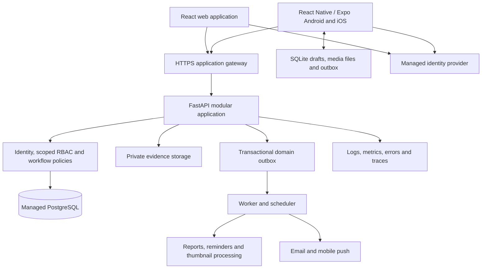

# Enertech 5S — Web and Mobile Product Master Plan

Prepared: 23 October 2026 · Reviewed: 24 October 2026 · Status: approved for implementation; local web increment in progress

This is a planning document. It does not authorize implementation, deployments, subscriptions, account creation, database changes, or app-store submission. Existing application code and data have not been changed for this study.

## 1. Recommended product direction

Build a focused 5S operations product for Enertech first, designed to support multiple plants and eventually multiple customer organizations. Deliver a desktop/tablet web application and Android/iOS mobile applications using the same business API, permission rules, database, evidence storage, and reporting definitions.

The defining workflow is:

**Define the standard → schedule the check → inspect the workplace → identify a deviation → assign an owner → capture the correction → independently verify it → measure whether the improvement lasts.**

Keep the existing React/TypeScript web application and FastAPI/SQLAlchemy backend. Refactor these incrementally into a modular monolith. Add PostgreSQL, managed authentication, private object storage, migrations, reliable background jobs, and a React Native/Expo mobile application. Share API contracts and business vocabulary between clients; use layouts suited to each device.

The recommendation is our engineering judgment, informed by the market study in [5S-MARKET-RESEARCH.md](5S-MARKET-RESEARCH.md). Vendor features are vendor-published claims, not capabilities tested in paid accounts.

### Working assumptions

| Topic | Planning assumption; owner may amend before approval |
|---|---|
| First customer | Enertech; one pilot plant, then other plants |
| Product model | Private company deployment first; tenant-safe foundations for future SaaS |
| Platforms | Responsive web + actual Android and iOS apps; Android pilot first if that matches the device fleet |
| Connectivity | Unreliable factory Wi-Fi; mobile offline capture is a release requirement |
| Languages | English first, localization architecture from the start; Hindi/Marathi after terminology review if needed |
| Identity | Individually attributable accounts, including on shared devices |
| Data location | Region selected after company residency and IT requirements are confirmed |
| Initial capacity envelope | 5 plants, 500 registered users, 50 concurrent online users, 10,000 tasks and 2,000 audits/month; assumptions for testing, not measured current use |
| Business scope | 5S, optional configurable Safety/6S, assets supporting 5S, improvement actions and reports |
| Not in first release | Full ERP, spare-parts purchasing, predictive maintenance, payroll, public marketplace, autonomous AI decisions |

## 2. What exists and what must change

This assessment comes from reading the repository, not executing production workflows or modifying either SQLite database. Current stack versions in package.json differ from README descriptions. Preserve existing uncommitted work before any future refactor.

| Area | Current evidence | Planned treatment |
|---|---|---|
| Web shell | `apps/web/src/App.tsx`: six tabs, local state, MaintainX-inspired components | Retain useful screens; introduce routes, deep links, API state management, role-specific navigation |
| API | `backend/app/api/`: plants, activities, red tags, audits, management, PDF | Retain FastAPI; separate routers, business services, policy checks and persistence |
| Hierarchy | Organization → plant → department → zone | Preserve; add team/shift membership, accountable zone ownership, optional workstations |
| Identity | Profile records and frontend persona switching; no authenticated-user dependency on business routes | Real sign-in, invitations, sessions, MFA for privileged users, scoped RBAC |
| Persistence | SQLite default relative to working directory; DB files exist in root and backend | Inventory both databases read-only before choosing source; migrate validated records to managed PostgreSQL |
| API failures | Many client operations silently fall back to in-memory arrays | Explicit server errors online; durable offline queue with visible pending/synced/conflict states |
| Work execution | Some status changes update React state only | Server-enforced transition commands and complete event history |
| Report submission | Client posts `/activities/{id}/report`; backend has no such route | One canonical submission contract, used by web/mobile and covered by contract tests |
| Approval | Server approval immediately completes work; some client fallbacks stop at approved | Agree one lifecycle and response shape; apply it everywhere |
| Evidence | URL-based evidence metadata; no complete private upload pipeline | Camera/file capture, validated private uploads, thumbnails, access-controlled downloads |
| Assets | Browser localStorage; no backend Asset model/API | Persist assets, hierarchy, ownership, status history, and work links centrally |
| Audits | Five aggregate pillar numbers; checklist JSON model exists | Versioned questions, answers, scoring rules, schedules, findings and review records |
| Audit navigation | AuditStation exists; not rendered in main navigation | Add first-class audit workspace and mobile execution flow |
| Trends | Backend repeats current results across Jan–Jun | Time-bucket actual historical events; show no data when history is unavailable |
| Deletion | Zone endpoint deletes associated activities and red tags | Archive master data; preserve historical records; restrict exceptional purge |
| Numbering | Random short activity/tag numbers | Transactional tenant/plant/year sequence with uniqueness and retry protection |
| Multi-plant integrity | Zone auto-creation can select first active plant; relationship checks incomplete | Explicit plant context and tenant/parent consistency checks on every write |
| Tests | Health, old demo plant expectations, activity/PDF lifecycle | Isolated PostgreSQL tests, realistic fixtures, permissions, sync and user journeys |
| Operations | Render blueprint and Vercel static config exist | Pick one supported deployment topology; add environments, backups, monitoring and runbooks |

### Preserve deliberately

Preserve the 5S pillar vocabulary, before/after comparison, work-order detail patterns, red-tag disposition concepts, activity history/comments, benefit fields, basic PDF capability and organization hierarchy. Components can be reused after API and usability corrections. Do not rewrite the entire product merely to change frameworks.

## 3. Product modules and management scope

P0 = secure internal pilot; P1 = production web/mobile release; P2 = later expansion. Foundational P0 database contracts must anticipate P1 mobile requirements.

| Module | Required behavior | Priority |
|---|---|---|
| Organization administration | Company settings, plants, departments, zones, timezones, units, working calendar and archive rules | P0 |
| People and access | Invite, activate/deactivate, roles, scoped memberships, teams, zone leaders, delegation, session revocation | P0 |
| Work and corrective actions | Create, assign, prioritize, schedule, execute, submit, review, rework, close, reopen, cancel; linked evidence and history | P0 |
| Evidence | Before/after photos, descriptions, annotations, upload progress, private access, revision history | P0 |
| Red tags | Item, quantity, reason, physical location, owner, quarantine, due date, disposition request/approval, execution and verification | P0 |
| Audit engine | Question-level 5S templates, versions, weights, N/A, evidence rules, drafts, schedules, findings, sign-off, action links | P0 |
| Asset register | Asset/sub-assets, code, zone, owner/team, photo, status, work history, import and QR labels | P0 |
| Management dashboard | Scope-filtered task, audit and red-tag metrics, actual trends, review backlog and drill-down | P0 |
| Notifications | In-app/email assignments, due reminders, overdue escalation, review requests and digest preferences | P0 |
| Mobile execution | My work, offline audits/actions, camera, QR, sync queue, push notifications and secure device session | P1 |
| Standards and sustain | WDGLL reference photos, SOP versions, daily/shift checks, recurring work, acknowledgement and training records | P1 |
| Improvement management | Kaizen suggestion → assessment → approved work → verified benefits → follow-up effectiveness | P1 |
| Reporting | PDF audit/activity dossiers, CSV/XLSX exports, weekly/monthly summaries, scheduled scoped reports | P1 |
| Reliability extension | Effective-time asset status events, planned/unplanned downtime and documented calculations | P1, basic history in P0 |
| Enterprise integrations | Microsoft/Google identity, HR imports, CMMS/ERP references, BI feeds, signed webhooks | P2 unless required for pilot |
| Commercial SaaS | Self-service tenant signup, entitlements, subscriptions, billing, support console | P2 |
| AI assistance | Draft descriptions/translations/checklists, detect possible repeated findings, summarize evidence with human review | P2 |

### Management screens that must be included

1. Company/plant setup wizard, working calendar, timezones and units.
2. People, invitations, teams, shifts, roles and permission scopes.
3. Department/zone hierarchy, leaders and backup responsibility.
4. Template library, draft/published versions, scoring and evidence policies.
5. Audit calendar, assignments, missed checks and approved rescheduling.
6. Action routing, due-date rules, review delegation and escalation policies.
7. Red-tag categories, quarantine areas, disposition approvals and authority limits.
8. Assets, sub-assets, status reasons, QR printing and CSV import.
9. Standards/SOPs, reference images and acknowledgement tracking.
10. Reports, export jobs, benefit verification, archive/retention settings.
11. Security sessions, role-change history and audit-event search.
12. Notification delivery failures, sync conflicts, failed imports and integration health.

## 4. Web and mobile experience

### User-supplied MaintainX reference

Reference: `C:/Users/User/Downloads/MaintainX Application UI.png`, supplied on 23 October 2026. Treat it as a visual and interaction reference; build Enertech branding and our own component system.

| Reference pattern | Planned application |
|---|---|
| Searchable asset list with adjacent details | Desktop assets and work orders: filters → selectable list → persistent detail pane |
| Details and Work Orders tabs | Asset details, related 5S work, evidence, standards and status history |
| Asset location and responsible teams | First-class zone/team relationships, enforced in API and database |
| Sub-assets | Parent-child assets with cycle prevention and separate history |
| Mobile detail cards and back navigation | Full-screen mobile detail; clear back path; no squeezed desktop split pane |
| Status history and uptime cards | Time-stamped state events, stated reporting window, explicit planned/unplanned downtime |
| Bottom navigation | At most five mobile destinations; role-appropriate tasks and large touch targets |

The screenshot's example hours are illustrative. They must never become seeded operational KPIs.

### Navigation

Web: Overview, My Work/Actions, Audits, Red Tags, Locations, Assets, Standards, Improvements, Reports, Administration. Show only permitted modules; routes still require API authorization.

Mobile: Home, My Work, Scan, Audits, More. Home shows assignments, due work and sync state. Red tags, assets, notifications, standards and account controls are accessible through contextual shortcuts/More. Supervisors receive a review queue; auditors receive scheduled inspections; management receives scoped summaries.

### Usability acceptance

- Desktop list/detail layouts; tablet adaptive layouts; phone single-column execution.
- Visible labels and validation beside fields; draft autosave; clear submit and retry behavior.
- State labels: saved on device, pending upload, synced, failed and needs conflict review.
- Default mobile touch controls approximately 48 dp on Android / 44 pt on iOS; web controls follow WCAG target-size rules with larger practical targets for factory use.
- Keyboard access, visible focus, screen reader labels, text resizing, contrast, reduced motion and no color-only status meaning; target WCAG 2.2 AA for web.
- QR entry preselects the correct zone/asset but never grants permission by possession of the code.
- Camera denied, low storage, lost connection, expired login and app restart are designed flows.
- No forced geolocation or biometric attendance; any later location capture must have a defined business purpose and permission flow.
- Shared device: named session, easy account handover, inactivity lock, isolated caches and visible current identity.

UX guidance here uses the skill's built-in reference rules; its search script could not execute because the local Python environment points to a missing base interpreter. No generated design-system match is claimed. Detailed screen designs remain a later approved deliverable.

## 5. Target architecture and stack



The diagram's outbox is a PostgreSQL table, not an independent storage service. Native uploads may go directly to private storage using short-lived upload grants issued by the API; finalization is authorized and validated by the API.

| Layer | Recommendation | Reason / boundary |
|---|---|---|
| Web | Retain React + TypeScript + Vite; add routing, query cache and typed forms | Existing investment; no SEO requirement that justifies a Next.js migration |
| Mobile | React Native + Expo, with production development builds | Actual Android/iOS apps; reuse TypeScript contracts and React knowledge; native camera, QR and push |
| Shared packages | Generated API client, enums, schemas, tokens and pure calculations | Share contracts; web DOM/CSS components do not directly become native components |
| Backend | FastAPI + Pydantic + SQLAlchemy async; domain modules | Preserve stack; keep authorization/transactions on server |
| Database | Managed PostgreSQL, SQLAlchemy and Alembic migrations | Relational integrity, concurrent updates, recovery and reporting |
| Identity | Managed identity; reference choice Supabase Auth, enterprise OIDC integration when required | Avoid implementing password/reset/MFA infrastructure from scratch; validate enterprise SSO needs and cost before provider lock-in |
| Evidence | Private Supabase Storage or S3-compatible service; provider adapter | Metadata in PostgreSQL; bytes in object storage; no public photo bucket |
| Jobs | PostgreSQL transactional outbox → Celery workers with managed Redis broker | Reliable reminders, reports and media processing; database is job/business source of truth |
| Notifications | In-app + transactional email; Expo push through APNs/FCM | Push delivery is best effort; inbox and database assignments remain authoritative |
| Delivery | Static web hosting + containerized API, worker, scheduler + managed services | Straightforward operations; separate staging/production |
| Monitoring | Centralized errors, structured logs, metrics and uptime checks | Diagnose failed saves, blocked sync, queue delay and performance |

Supabase is a proposed reference provider, not a requirement to expose the database directly to clients. Application data goes through FastAPI. Disable or restrict unused direct database APIs. Authentication sessions use provider-supported flows and SDKs. With enterprise OIDC, use authorization code + PKCE and registered mobile redirect links.

Default production topology: web and `/api` behind one application domain where practical; API/worker/scheduler on a paid managed container service, managed PostgreSQL/Auth/storage, managed Redis and transactional email. Existing Render configuration can be evolved after checking region, reliability and backup requirements. Free-tier deployment is development/demo infrastructure, not the production operating plan. An AWS/Azure company-standard environment can replace this topology without rewriting domain logic.

### Proposed repository boundaries, after approval

```text
apps/web/                 Existing web application, organized by domain
apps/mobile/              Expo Android/iOS application
packages/api-client/      Generated TypeScript API contracts
packages/domain/          Shared vocabulary and pure client helpers
packages/design-tokens/   Cross-platform colors, spacing, type scales
backend/app/modules/      Identity, organization, work, audits, tags, assets...
backend/app/policies/     Permission and workflow evaluation
backend/app/jobs/         Outbox dispatch, reminders, exports and processing
backend/alembic/          Reviewed schema migrations
backend/tests/            Isolated integration and policy tests
infra/                    Reviewed deployment/environment definitions
docs/                     Product specifications, ADRs and runbooks
```

Do not introduce microservices, Kubernetes, a separate search cluster, a data warehouse or machine learning infrastructure for the initial envelope. Split services only when measured operational constraints justify them.

## 6. Identity, scoped RBAC and separation of duties

Authentication answers who the person is. Authorization answers which operation they can perform on which records. Implement **permission + scope + record relationship + workflow state**, rather than a single global role string.

Example: a supervisor assigned to Plant A / Assembly may review Assembly actions in Plant A. That does not grant access to Plant B, manage organization administrators, or approve their own submitted correction.

### Default roles

| Role | Default scope | Main authority | Restrictions |
|---|---|---|---|
| Platform operator | Service operations | Tenant provisioning and system health | No routine customer-content access; exceptional support access time-limited, approved and logged |
| Organization admin | Organization | Plants, users, role grants, security and master settings | Administrative role alone does not approve operational work |
| Management viewer | Granted plants/organization | Dashboards, reports, improvement outcomes | Read-only unless explicitly granted another role |
| Plant manager | Granted plant(s) | Plant oversight, escalation, named high-authority approvals | No cross-tenant visibility; no own-work sign-off |
| 5S coordinator | Granted plants | Templates, schedules, standards and program reporting | Cannot assign unrestricted admin roles or independently approve own work |
| Department head / supervisor | Granted departments/zones | Assign work, review corrections, approve allowed dispositions | Operates only within granted scope and approval limits |
| Zonal leader | Granted zone(s) | Coordinate zone work, perform tasks, request disposition, monitor own zone | Review authority is a separate grant; no automatic self-review |
| Operator / contributor | Assigned work and allowed reporting zones | Raise observations/red tags, execute assigned work, submit evidence | No final approval, mass export or master-data administration |
| Auditor | Assigned audit scopes | Conduct inspections, create findings, submit reports | No silent edits to finalized answers; closure verification requires a separate permission and independence |
| External viewer / contractor | Explicit records and expiry | Limited view or assigned action execution | No inherited plant-wide browsing; disabled by default |

Users may hold multiple roles at different scopes. Teams route work; membership does not silently elevate privileges. Temporary delegation has start/end times, reason and audit trail. Custom roles can be introduced after preset roles are validated.

### Default permission matrix

All cells are limited to assigned scope. `Own` means created/assigned records, `Grant` requires an additional permission, `—` means denied.

| Operation | Org admin | Plant manager | Coordinator | Supervisor | Zonal leader | Operator | Auditor | Management |
|---|---|---|---|---|---|---|---|---|
| Manage users/role grants | Yes | Grant, bounded | — | — | — | — | — | — |
| Manage plants/departments/zones | Yes | Plant | Grant | — | — | — | — | — |
| Manage templates/standards | Grant | Grant | Yes | Propose | Propose | — | Propose | — |
| Create/assign work | Grant | Yes | Yes | Yes | Zone | Raise request | Finding-linked | — |
| Execute/submit work | Grant | Own | Own | Own | Own | Own | Own | — |
| Review/close work | Grant | Yes | Grant | Yes | Grant | — | Independent grant | — |
| Run audits | Grant | Grant | Grant | Grant | Assigned | Self-check only | Yes | — |
| Approve red-tag disposition | Grant | Within limit | Grant | Within limit | Request | Request | Finding only | — |
| Read reports | Admin metadata; content grant | Plant | Program | Scope | Zone | Own | Scope | Granted scope |
| Export detailed data | Grant | Grant | Grant | Grant | — | — | Grant | Grant |
| Security/permission audit log | Yes | Scope grant | — | — | — | — | Grant | Grant |

Permission keys include `work.create`, `work.assign`, `work.submit`, `work.review`, `work.reopen`, `audit.execute`, `audit.template.publish`, `redtag.disposition.approve`, `asset.manage`, `report.export`, `membership.manage` and `security.audit.read`. The approved matrix becomes executable policy tests.

### Enforcement rules

- Deny by default; authorize every API request, export, media grant and background job. This follows [OWASP authorization guidance](https://cheatsheetseries.owasp.org/cheatsheets/Authorization_Cheat_Sheet.html).
- Derive actor identity from verified session/token; never trust submitted actor/reviewer names or client permission flags.
- Verify token signature, trusted issuer, expiry and the provider's documented audience; validate membership and session status independently of token role claims.
- Organization context is selected from authenticated memberships, then all referenced parent/child records must belong to it.
- Scope restrictions apply to search results, counts, dashboards, reports, notifications, attachments and sync feeds as well as direct record endpoints.
- No self-approval; privileged overrides require a separate explicit policy, second approver where appropriate and recorded reason.
- Invitations cannot grant privileges above the inviter's delegation ceiling. Role changes, exports and support access are auditable.
- Revoke/deactivate membership centrally. Recheck queued mobile writes on reconnect. Offline access cannot be revoked instantly on a disconnected phone; limit its duration and cached content explicitly.
- Add PostgreSQL row-level security as defense in depth for tenant isolation. The API runtime role must not own/bypass protected tables; set tenant context transaction-locally, clear pooled connection context, and test cross-tenant isolation. Migrations use a separate privileged role. See [PostgreSQL row security](https://www.postgresql.org/docs/current/ddl-rowsecurity.html).

## 7. Database master design

Use UUID primary keys, database constraints, transactional writes and Alembic migrations. Use `timestamptz` UTC instants, plant-local calendar rules, Decimal/numeric money plus currency, explicit units and indexed foreign keys. Avoid storing business-critical relationships only as JSON or display names.

### Logical tables and relationships

| Domain | Proposed tables | Important links and purpose |
|---|---|---|
| Tenant/core | organizations, organization_settings, plants, departments, zones, workstations | Parent hierarchy; location names snapshot into finalized reports |
| People | users, memberships, teams, team_members, shifts, shift_assignments, zone_responsibilities | External identity subject → application user; many zone leaders with effective dates and primary/backup designation |
| Access | roles, permissions, role_permissions, role_bindings, invitations, delegations, device_sessions | Role binding includes tenant and organization/plant/department/zone scope; invitation expiry and grant ceiling |
| Work | work_orders, work_assignments, work_steps, work_events, work_comments, approval_requests, approval_decisions, work_links | One action engine for audit findings, red-tag follow-up and improvements; immutable decisions and explicit source links |
| Recurrence | recurrence_rules, work_occurrences, working_calendars, calendar_exceptions | Materialize due work exactly once per schedule occurrence; plant-local timezone and missed-run policy |
| Evidence | media_objects, work_evidence, audit_answer_evidence, red_tag_evidence, asset_media | One private media object with explicit domain links, ownership, purpose, checksum, scan state and retention |
| Audits | audit_templates, audit_template_versions, audit_sections, audit_questions, audit_response_options, audit_schedules, audit_occurrences, audit_runs, audit_answers, audit_findings, audit_reviews | Runs pin an immutable template version; answers hold actual evidence/response and server-derived score |
| Red tags | red_tags, red_tag_events, disposition_requests, disposition_decisions, disposition_executions, quarantine_locations | Separate proposal, authority approval, physical execution and closure verification |
| Assets | assets, asset_assignments, asset_status_events, downtime_intervals, asset_work_links | Parent asset in same tenant; event-derived status, planned/unplanned reason, zone, team and historical work |
| Standard work | standards, standard_versions, standard_acknowledgements, training_assignments, training_completions | WDGLL photos/SOPs, revision validity, role/site applicability and acknowledgement |
| Improvements | improvement_proposals, improvement_reviews, benefit_claims, benefit_verifications, effectiveness_checks | Separate proposed benefit from verified recurring/one-time saving; links to work and follow-up |
| Messaging | notifications, notification_preferences, notification_deliveries, push_devices, escalation_policies | User-visible inbox, per-channel attempts, deduplication and escalation checkpoints |
| Integrations/jobs | domain_outbox, job_runs, import_jobs, import_row_errors, export_jobs, integration_connections, webhook_deliveries | Durable work, retry history and traceability; credentials encrypted or secret-manager referenced |
| Auditability/sync | security_audit_events, idempotency_records, sync_changes, sync_checkpoints, record_tombstones | Append-only access/business audit, duplicate protection, bounded delta feeds and deletion/visibility propagation |

These are logical boundaries, not a mandate to create every table in the first migration. Implement phase-owned tables with reviewed migration dependencies. Keep audit-run history and tenant keys stable from the first pilot.

### Required integrity rules

- Every tenant-owned record has `organization_id`. Composite foreign keys or equivalent validated constraints prevent cross-tenant references, including media and join tables.
- Plant/department/zone parents must agree; assignments must reference active users in an allowed scope. Asset parentage must not form cycles.
- Unique codes within agreed parent scope; work/tag human-readable numbers unique per organization, generated by atomic counters/sequence allocation, never random short numbers.
- Check score bounds, positive quantity, due-date semantics, permitted enum values and required reasons. Validate at API and database layers where possible.
- Add `version` for optimistic concurrency on mutable records. Use compare-and-update/ETag behavior; reject stale transitions with a conflict response.
- Normalized template versions are immutable after publication. Published audit answers cannot be overwritten; corrections create a revision with reason and author.
- Transactionally commit record, status event, approval decision and outbox message together. Email/push failure must not roll back a successfully saved correction.
- Index common filters: tenant + plant + status + due date; assigned-user work; zone/time audits; tag aging; event timestamps and sync cursors. Use pagination rather than unbounded collections.
- Archive master data with effective dates; historical work remains linked. Restrict cascades to disposable drafts or explicitly owned transient records. Handle legal holds and retention separately from ordinary archive.
- Do not fabricate zone scores: no qualifying audit means unassessed, with last-audited date visible.
- Security audit events are append-only to application roles, with restricted access and export. Stronger tamper evidence/object lock is a later requirement if regulated customers need it.

### Schema migration and existing data

1. Preserve existing uncommitted code; snapshot both SQLite files and identify which is used by each launch configuration.
2. Read-only inventory: table counts, IDs, duplicate codes, missing parents, demo records, file URLs and timestamps. Produce a mapping and exception report.
3. Define authoritative source and record retention with owner. Do not merge root/backend databases blindly or delete demo records automatically.
4. Introduce Alembic baseline and reproducible empty PostgreSQL setup. Production schema updates run as controlled release jobs, not startup `create_all`/seed.
5. Dry-run migration in staging; preserve stable IDs where possible; create an identity mapping for real users. Profiles do not become authenticated accounts merely by copying rows.
6. Import localStorage assets through a user-visible export/import process from each browser/device; the server cannot discover every browser's local assets.
7. Reconcile counts, sampled relationships, before/after evidence and report results; classify missing evidence honestly.
8. Take a cutover backup, freeze writes for an agreed short window, perform final migration and smoke checks, then enable clients. Keep a rollback plan and account for writes made after cutover before any rollback.

## 8. Business rules and state machines

### Work/corrective action

`draft → assigned → in_progress → submitted_for_review → completed`

Review may instead move `submitted_for_review → changes_requested → in_progress`. `cancelled` requires reason and authority. Reopen creates a new transition with reason and preserves prior closure. `overdue` is a derived condition, not a replacement status. Record approval as a durable decision event; completion follows successful verification in the same transaction for the default one-reviewer workflow.

Assignment requires owner, scope and due date or a recorded exception. Submission requires corrective action and policy-required evidence. Review rejects incomplete submissions, enforces independence and records actor/time/reason. Client buttons cannot directly assign arbitrary statuses. The final enum migration maps existing `rejected`, `approved` and `completed` records without erasing history.

### Audit

`scheduled → in_progress → submitted → reviewed/finalized`, with explicit cancelled/missed outcomes and reasoned rescheduling. Draft save is separate from final submission. A missed occurrence remains visible even if a later audit is performed.

Question types: pass/fail, score scale, numeric measure, text, selection, photo and acknowledgement. Define applicability, pillar, max score, weight, criticality and required evidence. Failed answers create findings; findings link to actionable work. Avoid duplicate actions when a known open finding already exists; require a deliberate link/reuse decision.

Default normalized weighted score:

`score % = 100 × Σ(weight × earned / maximum) / Σ(applicable weight)`

Exclude approved N/A responses from numerator and denominator; require an N/A reason. If no applicable scored questions remain, show no score, not 100%. Calculate per-pillar scores with the same rule. Define separate critical-failure flags that can block pass even with a high percentage. Pin weights, response mappings, rounding and pass policy to the template version; the backend calculates scores. Cross-zone comparisons require the same compatible scoring/version scheme or a visible compatibility label.

### Red-tag disposition

`open → assessed → disposition_requested → disposition_approved → executed → verified_closed`.

Allow request_changes/hold branches with reason and owner. Include item photo, quantity/unit, location, reason, hazard/priority, custodian, deadline and disposition cost/value where relevant. Scrap/return decisions may require elevated approval based on item value or policy. The person requesting disposal does not automatically verify it. A photo and disposition note alone must not imply physical disposal occurred.

### Asset status and reliability

Initial states: online, offline/unplanned, planned maintenance, retired; definitions approved by operations. Store effective time, server recorded time, actor, reason, related work and correction history. Resolve overlapping intervals and late offline events explicitly.

Within a selected operating window, calculate planned downtime, unplanned downtime and known uptime using intersected intervals. Show unknown time separately. Availability = known uptime / (known uptime + unplanned downtime) when planned downtime is excluded by the chosen policy; show the definition and coverage. Do not imply 24/7 operation unless the calendar says so. MTBF/MTTR require qualifying failure/repair events and enough reliable history; defer them until that data exists.

## 9. Offline mobile and synchronization

Mobile offline support is a designed subsystem, not the existing silent in-memory fallback. Expo supplies local database/storage primitives; application sync and conflict behavior still have to be implemented and tested. See [Expo local-first guidance](https://docs.expo.dev/guides/local-first/) and [SQLite SDK](https://docs.expo.dev/versions/latest/sdk/sqlite/).

### Offline scope

| Activity | Offline policy |
|---|---|
| Read previously downloaded assigned work, standards and templates | Yes, within cache/access expiry |
| Save audit answers, task notes and photos | Yes, durably on device |
| Create a red tag or observation | Yes, temporary UUID and provisional display number |
| Submit correction/audit | Queue a submission intent; final server acceptance waits for sync and required uploaded media |
| Final approval, disposal approval, role change and template publication | Online only in first release |
| Download unseen records, log in first time or switch organizations | Online required |
| Management analytics and generated exports | Online required; previously cached reports clearly dated |

### Sync contract

1. Bootstrap only authorized scope and published template versions; display last successful sync and downloaded coverage.
2. Store drafts/changes in SQLite and media in application-private files. Encrypt sensitive cache where required; protect encryption keys/tokens with platform keystore facilities. SecureStore protects small secrets, not the entire local database by itself.
3. Every queued operation carries client UUID, idempotency key, base record version, device identity, organization and local capture time. Server identity is authoritative; preserve both captured and received timestamps.
4. Upload media with retry/resume where supported; verify object metadata/checksum and processing status, then finalize dependent submission. Retain local photos until acknowledgment and local retention policy allow cleanup.
5. Push queued commands in dependency order. A network timeout after server commit retries the same idempotency key and returns the original result.
6. Pull authorized deltas via opaque server-issued cursor, including tombstones and access-loss events. If permissions change, invalidate/rebootstrap affected cache scope so old records are removed even if those records themselves did not change.
7. Conflict rules: append-only comments/photos usually merge; competing answer/field edits need version checks; closed/reassigned work cannot silently revert; server authority and current authorization win for final transitions. Present recoverable drafts and explicit conflict resolution.
8. Use bounded retries with backoff, retryable vs permanent errors, per-operation status and a support diagnostics reference. Never show failed validation or forbidden actions as saved to server.
9. Access expiry stops further protected offline access according to approved policy. Logout wipes session-readable cached content and tokens; warn about pending work before voluntary logout and provide a governed recovery policy. Shared-device users cannot see another person's unsynced work.
10. Do not promise continuous background sync: iOS/Android control background execution. Foreground/manual sync is reliable and visible; background tasks are opportunistic.

Proposed initial offline-access allowance: one shift, maximum 24 hours since last online authorization, subject to company risk/device policy. Revocation is enforced immediately on the server and at next device contact; disconnected cached data remains a residual risk to manage with cache limits and managed-device policy.

Web PWA installation and resilient drafts are useful additions, but do not replace testing native mobile offline behavior. If full offline web audits are later required, treat IndexedDB/service-worker sync as a separate supported capability and test it independently.

## 10. API and service contracts

- Versioned REST `/api/v1` with generated OpenAPI TypeScript client; explicit enums, pagination, filtering/sorting, validation limits and stable error codes.
- Resource APIs for hierarchy/assets/standards; commands such as start, submit, review, reopen and request-disposition for transitions. Do not expose unrestricted `status` mutation.
- One canonical report submission endpoint used by web and mobile. Define it before removing duplicate legacy helpers; contract tests enforce payload/response agreement.
- Standard error envelope: code, user-facing message, field errors, request ID and retryability; 401 unauthenticated, 403 forbidden, 404 unavailable/not found, 409 conflict, 422 invalid input, 429 throttled.
- Idempotency on creation, transitions, review, occurrence generation and media finalization. Deduplication includes request fingerprint; reused key with a different payload is rejected.
- Authenticated upload-init/finalize/download-grant endpoints; allowlisted types, size limits and private object prefixes. Authorization applies to each object.
- Reporting/export is permission-checked when requested and again when downloaded; jobs retain scope/filter snapshot, requester, expiry and generation time.
- Server-side filtering and aggregate definitions prevent each frontend computing different official totals.
- Background tasks use explicit tenant and actor/system context, narrow credentials and the same business policy rules. A cron job is not an authorization bypass.
- Signed, replay-protected webhooks, delivery retries and scoped integration accounts for future integrations.
- Maintain compatible API versions during mobile upgrade windows; return minimum-supported client version and a safe upgrade path.

## 11. Evidence, documents and retention

Media lifecycle: `pending_upload → uploaded → quarantined/processing → ready` or `rejected`. Work can save a draft while media is pending; final submission waits for required evidence to be ready.

Store object key, organization, uploader, capture/receive times, mime type, size, checksum, processing result and domain purpose. Validate actual content instead of trusting filename; restrict SVG/HTML and executable content. Scan supported files, sanitize image derivatives and create compressed previews. Preserve original and annotations separately when evidence policy requires originals. Remove unnecessary EXIF location from served derivatives unless explicitly required.

Use short-lived read grants issued after access checks. Avoid arbitrary server fetching of user-provided photo URLs; a controlled import path must prevent internal-network requests. PDF rendering must not load unrestricted external URLs.

Define tenant-configurable retention by record class before production, including database backups, object versions, exports, device caches and audit logs. Proposed starting point for discussion: operational evidence three years, security events one year, export links seven days, device cache seven days of relevant work subject to shorter access expiry. These are product defaults to review, not legal retention advice. Legal/contract requirements must be confirmed with the company's responsible adviser; do not label the software compliant merely because these controls exist.

## 12. Dashboards, reports and metric definitions

| Metric | Definition and safeguards |
|---|---|
| Audit completion | Completed scheduled occurrences / due non-cancelled occurrences within the selected local-date range; show late completions separately |
| Audit score | Server-calculated weighted score; show template version, inspected date and applicable coverage |
| Zone status | Latest qualifying finalized audit plus age; stale/unassessed labels; do not carry old good scores forever |
| Overdue work | Unclosed, non-cancelled work past due timestamp; changes-requested work remains actionable |
| Closure time | Creation/finding time to verified completion; define reopened-cycle treatment; median and percentile useful alongside mean |
| Repeat findings | Same criterion/location recurrence with reviewed linking rules; no unsupported AI certainty |
| Red-tag aging | Creation to verified closure, or current time for open tags; use buckets and disposition backlog |
| Review backlog | Submitted corrections awaiting eligible reviewer; show age and escalation |
| Benefit saving | Estimated vs verified, one-time vs recurring, currency, baseline, period and approver; prevent duplicate counting |
| Asset availability | Event-derived windowed result with operating calendar and known-data coverage |

Reports: individual before/after work dossier; audit with question responses, findings and action status; red-tag register; zone/plant pillar trend; missed-audit report; overdue/escalation report; verified-benefit report; user activity/security review for authorized administrators.

Use genuine time-bucketed history. Display filter window/timezone and generated-at time. Support drill-down and scoped PDF/CSV exports, then XLSX and scheduled delivery. Exclude or escape spreadsheet formula-leading user content on CSV/XLSX export. Scheduled reports reevaluate recipient permissions at delivery time and use expiring authenticated access for sensitive content.

## 13. Security, reliability and operations

### Before production

- Remove development default secrets from production configuration; validate required secrets at startup; exact CORS origins; HTTPS; security headers; request/upload/rate limits.
- Privileged MFA, invitation verification, recovery process, device/session management and sensitive-action reauthentication where supported.
- Browser session design chosen deliberately: prefer same-site secure HttpOnly session cookies via a session layer; add CSRF protection. Mobile uses provider-supported tokens in secure storage. Do not place long-lived secrets in localStorage or URLs.
- Database encryption at rest via provider, TLS connections, least-privilege application/migration roles, separate staging/production and secret rotation.
- Dependency lockfiles and supported stable runtime versions; verify current unusual dependency declarations against available registry versions during foundation work, not during this planning exercise.
- Audit who changed settings, roles, approvals, due dates, evidence and exports; redact tokens and private attachment links from logs.
- Malware/file validation, tenant isolation and object-level access tests; independent penetration review before external SaaS launch.
- Privacy notices, data ownership/export/erasure procedures, incident handling and app-store privacy declarations matched to actual behavior.

### Backups and disaster recovery

Use managed PostgreSQL automated backups plus point-in-time recovery; object-storage versioning/backup policy separately. PostgreSQL backup does not back up image bytes. See [PostgreSQL PITR](https://www.postgresql.org/docs/current/continuous-archiving.html).

Proposed pilot targets: RPO ≤24 hours and RTO ≤8 hours; production targets RPO ≤1 hour and RTO ≤4 hours, subject to paid provider capabilities and restore drills. Alert on backup failures; rehearse restores into an isolated environment and verify both records and evidence. Specify backup retention, region and authorized restore operators. Keep incident, outage, failed migration, bad release and lost-device runbooks.

### Availability and performance targets

Proposed release targets, to validate against realistic usage: 99.5% monthly service availability for initial production; p95 ordinary read API <500 ms and write API <800 ms under the agreed 50-concurrent-user test, excluding network/media transfers and slow exports. First usable mobile/web task list within 3 seconds on agreed representative devices/network. Offline drafts survive process termination. Large exports/media processing are asynchronous. These are acceptance targets, not current performance claims or contractual SLAs.

Monitor request errors, latency, DB pool saturation, slow queries, worker lag, outbox age, reminder failures, media processing, storage growth, mobile crashes, sync conflicts and authorization-denial anomalies. Health endpoints distinguish process liveness from database/dependency readiness.

## 14. Delivery plan and acceptance gates

Indicative sequence: 18–26 calendar weeks for a small experienced team with web/backend/mobile coverage, QA and an available product owner; actual estimates follow approved scope, designs and a technical spike. This is not a fixed-price or delivery commitment. Some work can overlap after contracts stabilize.

| Phase | Indicative duration | Main deliverables | Exit evidence |
|---|---|---|---|
| 0 — Validate specification | 1–2 weeks | Scope approval, actual plant/user/device inventory, process examples, role matrix, template/scoring agreement, provider decisions, migration inventory, screen flows | Signed-off pilot scope and acceptance checklist; no unresolved critical workflow rule |
| 1 — Secure foundations | 2–3 weeks | PostgreSQL/Alembic, identity, tenant/scoped policies, environments/CI, API errors, audit log, private media proof, first mobile camera/offline spike | Two-tenant isolation tests, role-grant tests, reproducible migrations, real-device sync proof and isolated restore |
| 2 — Core execution web | 3–4 weeks | Persisted assets/locations, complete work lifecycle, evidence, red-tag workflow, people/team management, reliable numbering and reports | Two-user create → submit → reject/rework → verify lifecycle survives reload; no fake success fallback |
| 3 — Audits and sustain | 3–4 weeks | Template builder/versioning, schedules, answers/scoring, findings/actions, standard work, reminders and actual dashboards | Scoring fixtures, N/A/critical cases, timezone/shift tests and recurring job duplicate protection |
| 4 — Mobile completion | 4–5 weeks | Native task/audit/tag flows, camera/QR, durable outbox, conflict UI, push, shared device behavior, Android/iOS release candidates | Airplane-mode shift, killed-app recovery, duplicate/reordered sync, expired access and revoked-membership tests on physical devices |
| 5 — Pilot and release | 3–4 weeks | Migrated pilot data, UAT, accessibility/security/load checks, training, recovery rehearsal, store distribution and support handover | Pilot metrics accepted, zero unresolved critical/high security findings, reconciliation and restore passed, owner go-live approval |

Milestones: secure foundation → web internal pilot → question-level audit pilot → native offline pilot → production web + Android/iOS. Web pilot approval does not imply mobile or external commercial readiness.

### Ordered implementation backlog after approval

1. Freeze agreed vocabulary/statuses and record current endpoint contracts.
2. Snapshot/inventory existing data; establish migrations and PostgreSQL integration tests.
3. Implement identity and tenant membership, then scoped permission middleware/services and role administration.
4. Secure organization hierarchy and assignment integrity; fix first-plant inference.
5. Establish standard errors, concurrency/idempotency, event history and transactional outbox.
6. Prove private evidence upload/download, native camera and durable offline operation early.
7. Move assets from localStorage to database; add hierarchy/status history and import reconciliation.
8. Make work transitions and report submission server-authoritative; remove silent mutation fallbacks.
9. Implement red-tag approval/execution/verification.
10. Add normalized audit versions/questions/answers, scoring, occurrences and finding-to-action links.
11. Add standards, recurring tasks, reminders/escalation and verified benefits.
12. Replace fabricated trends and inconsistent local metric calculations with scoped reporting APIs.
13. Complete mobile journeys and sync conflict/access-loss rules.
14. Harden operations; run migration rehearsal and pilot; approve rollout.

### Definition of production ready

- Real authenticated users; permission matrix enforced on every channel; no cross-tenant/plant leaks.
- Every operational save persists centrally or is explicitly marked pending on a device.
- Core web and mobile flows agree on statuses, validation, scores and totals.
- A complete disconnected audit/action shift survives app restart and syncs without lost or duplicate accepted records.
- Private evidence, full question-level history, required review independence and retained closure records.
- Background retries do not duplicate reminders, occurrences or approvals.
- PostgreSQL/object restores, deployment rollback and client-version compatibility have been demonstrated.
- Critical journeys tested on Chrome/Edge/Safari and representative physical Android/iOS devices; accessibility review completed.
- Supported runtime/dependency versions, monitoring, incident contacts, operator runbooks and user training are in place.
- Pilot owner accepts data migration, workflows and measured usage outcomes; production go-live explicitly approved.

## 15. Test strategy

Use isolated disposable PostgreSQL databases, synthetic media and separate identity test tenants. Never run mutation tests against the existing local business database.

| Layer | Meaningful coverage |
|---|---|
| Domain/policy | Allowed/forbidden transitions, own-work approval, role-grant ceilings, scope inheritance, benefit verification and disposition limits |
| Database/API | Constraints, migrations, rollbacks, tenant isolation, actor derivation, pagination, upload ownership, stale updates and idempotency |
| Audits | Score boundaries, weighted/N/A/all-N/A, critical failure, immutable versions, changes after publication and timezone recurrence |
| Contract | Generated client agrees with actual endpoints, including report submission and review decisions |
| Web end-to-end | Admin onboarding → supervisor assignment → worker evidence → independent review; audit finding → correction; red-tag execution |
| Mobile/sync | Airplane mode, process kill, low storage, media retry, timeout after server commit, two-device conflict, template withdrawal, access loss and cache segregation |
| Operations/security | Private file URLs, export scope, rate limits, dependency checks, backup restore, failed worker recovery and realistic load |

Fix stale demo fixtures before treating existing tests as a reliable baseline. Run CI checks on every approved change; release checks include build/lint/type checks, backend integration tests, migration checks and targeted end-to-end suites.

## 16. Cost model and team ownership

No current vendor quote or pricing commitment is assumed. Obtain dated quotes after selecting regions and sizing. Account for:

- API, worker and scheduler compute; managed PostgreSQL capacity/PITR; Redis; private object storage; media egress/CDN; authentication/SSO/MFA; transactional email; error/log retention; native build/distribution and app-store developer accounts.
- Staging, backups, restore capacity, support and ongoing maintenance; security review and device testing.
- One-time development effort separately from recurring hosting and support.

Illustrative storage sizing: 20,000 photos/month × 2 MB original = approximately 40 GB of new originals/month, or 480 GB/year before thumbnails, versions and backups. This is an assumption, not measured usage. Media retention/quality and egress can outweigh API compute cost; set quotas, compression targets and spend alerts.

Use a cost worksheet: monthly cost = compute + database/PITR + broker + stored GB × storage rate + downloaded GB × egress rate + authentication + messages + monitoring + build/distribution + support. Include taxes and currency conversion only using current quotes when budgeting is requested.

Named responsibilities needed: product owner/5S process owner, technical lead/backend owner, web owner, mobile owner, QA/release owner and operations/security owner. One person can cover several roles, but each responsibility needs an accountable person.

## 17. Risks and controls

| Risk | Planned control |
|---|---|
| Scope expands into full CMMS/ERP | Keep 5S execution central; asset basics in core, purchasing/predictive maintenance deferred |
| Offline sync underestimation | Real-device prototype in foundations; dependency-aware outbox and explicit conflict policy |
| RBAC exists only in menus | Server policy layer, DB tenant defense and adversarial role/scope tests |
| Losing evidence or confusing local with server saves | Private upload lifecycle, persistent queue, visible acknowledgment and restore tests |
| Misleading management KPIs | Versioned scoring, actual time buckets, verified benefits and unknown coverage labels |
| Data deletion damages traceability | Archive master data; immutable finalized records and restricted retention purge |
| Mobile release slips | Stable API contracts early; continuous physical-device tests; staged distribution before store release |
| Provider lock-in / region mismatch | Standard PostgreSQL and storage/identity adapters; validate residency, export and restore early |
| AI invents standards or approvals | AI later, suggestions only; human-reviewed outputs, permission filtering and clear provenance |
| Low adoption | One-zone pilot, supervisor/operator feedback, low typing burden and short practical training |

## 18. Approval decisions

Approve or amend these together before implementation:

1. Enertech-first, multiple-plant product with tenant-safe foundations; commercial SaaS billing later.
2. Retain React/FastAPI; managed PostgreSQL/Auth/private storage; React Native/Expo for Android and iOS.
3. P0/P1 scope and the phased milestones in this plan, including reliable offline mobile as a production gate.
4. Scoped RBAC, independent review, archive-preserved history and question-level audit scoring.
5. MaintainX reference interaction patterns with Enertech branding, including assets/sub-assets and evidence-based status history.
6. Phase 0 will confirm user/device counts, pilot plant, language needs, identity/hosting requirements, retention, delivery team and budget ceiling before paid service commitments.

**Approval means permission to begin the agreed implementation phase. It does not authorize purchases, public deployment, production data cutover or app-store publication without the corresponding later release decision. Until approval, work remains research and planning only.**
